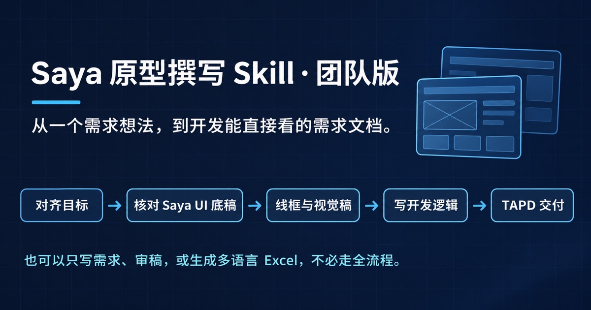

# Saya 原型撰写 Skill｜团队版 v1.0

**需求目标 → Saya UI 底稿 → 线框和关键文案 → 视觉稿／按需模拟器 → 开发逻辑 → 确认稿 → TAPD 交付 → 确认后归档。**

产品负责做决定，AI 负责找材料、画原型、写规则和自查。不用先手画一套图，也不必每次走完全部步骤。

## 怎么用

1. 解压分享包，把整个 `saya-prototype-writing` 文件夹放在工作项目的 `.agents/skills/` 下；也可放到用户目录下的 `.agents/skills/`，供本机多个项目共用。保留里面的 `SKILL.md` 和 `references/`，不要只复制主文件。同一环境已有同名版本时只选用一份，不直接覆盖已有文件。
2. 在 Codex 中选用 Skill，或在支持 `$` 调用的界面使用 `$saya-prototype-writing`。如果列表未出现，参照 [Codex 官方安装位置和调用说明](https://learn.chatgpt.com/docs/build-skills) 核对目录。暂不安装也可把文件夹放在当前工作区，在对话中明确让 AI 读取其中的 `SKILL.md` 和相关参考。
3. 起手告诉 AI 三件事：**想解决什么、手上有什么资料、这轮做到哪一步**。一张能看到现有布局的 Saya 截图或一个能打开的 Figma 画板就能开始。最好说明页面状态、谁在用，以及哪些区域不能动。没有底图时可以先讨论或出结构示意。

## 可以直接复制的开场白

- **从想法开始**：「用 `$saya-prototype-writing`。我想让房主更容易找到公告设置。现有界面如图。这轮先说清改动范围和入口位置，不出图。」
- **开始画原型**：「入口已确认。照这张 Saya 截图先出线框，保留原底栏，不改原有按钮；我确认后再出视觉稿。」
- **已有图只写需求**：「这个原型确认了，只写第一模块的开发逻辑，包括谁能看到、怎么操作、没有权限时怎样；不补图、不写数据章节。」
- **出多语言表**：「把下面定稿文案翻译成全语种，保留 `NUM`，输出后台上传 XLSX，不上传。」
- **只做 TAPD**：「这里是确认稿和配图。帮我准备 TAPD 录入，先填到提交前。不要重新写稿。」

团队版不含个人工作资料、历史案例、Saya UI 素材或账号权限。TAPD、Figma、团队归档库按各自权限使用；没有权限时可交离线稿或明确缺项。TAPD 内容录齐并回查后，AI 会询问是否归档；不默认提交、公开发布或写入知识库。
